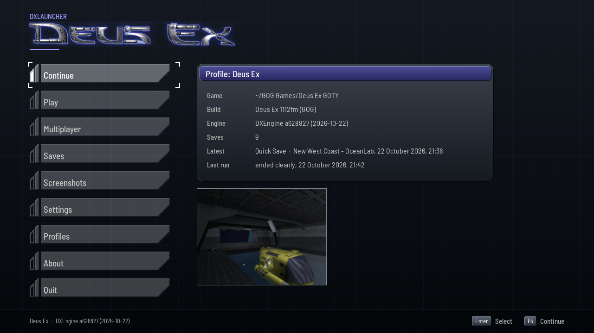
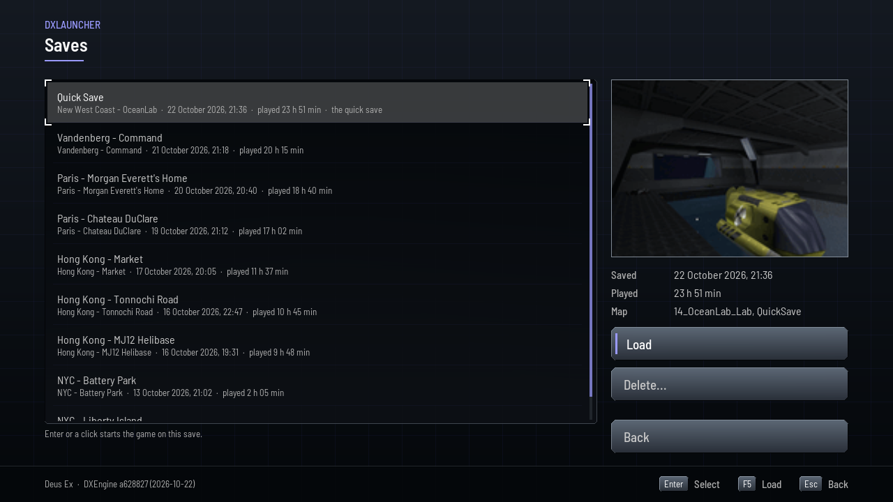
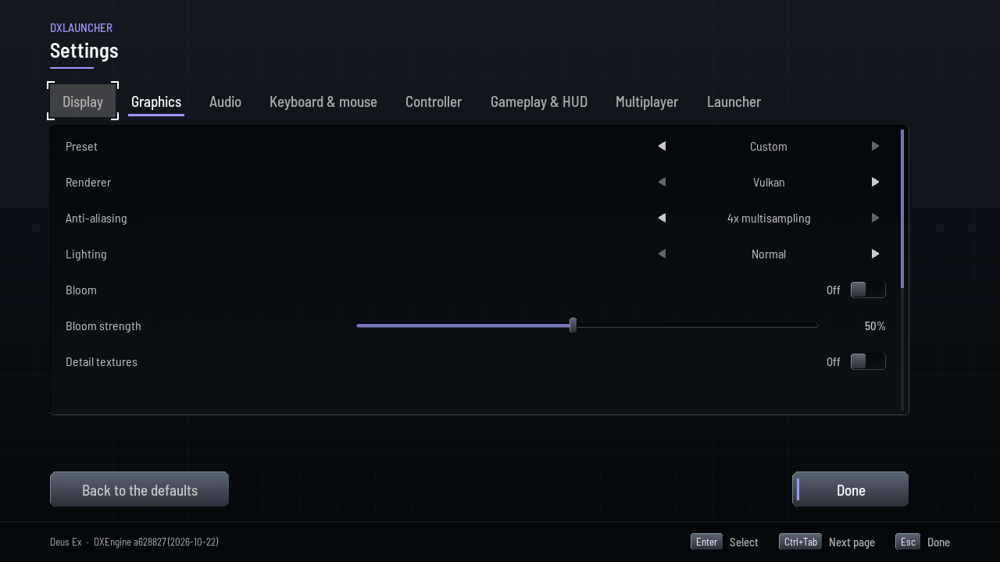
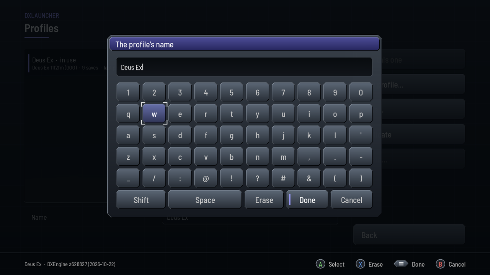
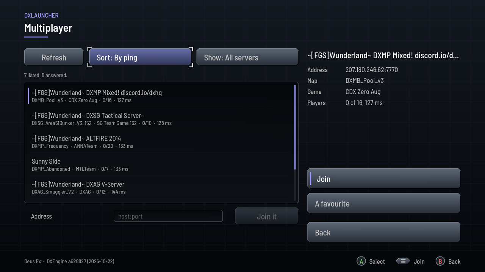

# DXLauncher for the TrimUI Smart Pro

Deus Ex on the TrimUI Smart Pro, a handheld running spruceOS: DXLauncher,
the launcher, tailored to the device's screen and pad, with
[DXEngine](https://github.com/JuggyMcNutty/DXEngine) beside it. It finds
the game on the SD card, keeps each way of playing in a profile, with its
own settings, saves and screenshots, starts the engine and stays with it. It
wears the game's look and sound.

<p align="center">
  
</p>

**You need your own copy of Deus Ex, version 1112fm** (1002f, the first
release, runs with a warning). None of the game's files are included. DXLauncher is part of
[Port Ex Machina](https://github.com/JuggyMcNutty/port-ex-machina). Made with
AI assistance.

**Status**: the launcher and the engine run on the device, and the game runs
on Vulkan or OpenGL ES, or on the CPU with Software, at 853 × 480 by default
([performance](ports/trimui-smartpro/README.md#performance)), not fully
playable ([where the engine differs](https://github.com/JuggyMcNutty/DXEngine/blob/main/docs/NATIVES.md)).
An alpha: [where to report a bug](https://github.com/JuggyMcNutty/port-ex-machina/blob/main/README.md#reporting-bugs).

## Features

- **Made for the handheld**: full screen at its 1280 × 720, driven by its
  own pad from the first frame, with an on-screen keyboard for text.
- **It finds the game** in spruceOS's Ports folder, `Roms/PORTS/DeusEx` on
  the SD card. The first run makes a profile from it, the game's settings
  and keys imported. Nothing in the game's folder is written but an ini a
  command line names (`INI=`, `USERINI=`).
- **CPU modes**: spruceOS's Smart, Performance (all four cores at 1.8 GHz)
  or Overclock (2.0 GHz, the default) while the game runs; the menu's own
  power-save comes back as the game ends.
- **The device's defaults**: the scene drawn at two thirds of the screen's
  size and scaled up, anti-aliasing and VSync off.
- **Profiles**: one for each way of playing, with its own settings, keys,
  controller, saves and screenshots.
- **Settings**: those the engine really reads, on eight pages: display,
  graphics, audio, keyboard and mouse, controller, gameplay and HUD,
  multiplayer, and the launcher's own.
- **Saves and screenshots**: Continue on the latest save, load or delete
  any, look through the game's screenshots. A delete is for good, after
  the page asks.
- **Multiplayer**: the game's servers, from the local network and
  333networks' master server; favourites, passwords, an address joined.
- **Mods**: each played through a profile of its own, its folders first.
- **Recovery**: after a crash, how the run ended, the end of its log, and
  what to try next.

## Screenshots

<table>
  <tr>
    <td width="50%"></td>
    <td width="50%"></td>
  </tr>
  <tr>
    <td align="center">Saves, each with its snapshot</td>
    <td align="center">Graphics: the CPU mode</td>
  </tr>
  <tr>
    <td width="50%"></td>
    <td width="50%"></td>
  </tr>
  <tr>
    <td align="center">The on-screen keyboard</td>
    <td align="center">The game's servers</td>
  </tr>
</table>

The shots are of this branch's PC build, at the Smart Pro's 1280 × 720.

## Download

Take `DX-trimui-smartpro.zip` from
[Port Ex Machina's releases](https://github.com/JuggyMcNutty/port-ex-machina/releases):
DXLauncher with DXEngine, as a [spruceOS](https://github.com/spruceUI/spruceOS)
app. On the SD card, `/mnt/SDCARD` on the device and the card's own top
folder in a PC's card reader:

1. Unzip it into `/mnt/SDCARD/App/`, which makes the app's folder,
   `/mnt/SDCARD/App/DeusEx`.
2. Copy what the game's folder holds, a GOG or Steam install's `System`,
   `Maps`, `Textures` and the rest, into `/mnt/SDCARD/Roms/PORTS/DeusEx`, so
   that `/mnt/SDCARD/Roms/PORTS/DeusEx/System/DeusEx.exe` is there.
3. Start Deus Ex from spruceOS's apps.

This repository's releases tagged `trimui-smartpro-<date>-<commit>` have the
launcher alone.

## Building

Port Ex Machina fetches this branch beside the engine, cross-builds both
from a PC and deploys them to the device over SSH
([the port](ports/trimui-smartpro/README.md#build-and-run)):

```sh
scripts/dx.sh deps   trimui-smartpro   # the toolchain and the sysroot
scripts/dx.sh test   trimui-smartpro   # the unit tests, on the PC's build
scripts/dx.sh deploy trimui-smartpro   # build, stage, send
```

## The branch

`trimui-smartpro` is linux-aarch64's launcher with the Smart Pro's port
(`ports/trimui-smartpro`, its preset in `CMakePresets.json`) and its
tailoring, each a commit of its own on top of linux-aarch64's
([what differs](ports/trimui-smartpro/README.md#what-differs-from-linux-aarch64)):
an SDL3 video driver for the device's framebuffer and EGL, the spruceOS
app, the CPU modes, the big screen alone, the game full screen alone, no
desktop, deleting for good, a pad without stick clicks, spruceOS's Ports
folder, the device's data, no Mesa CPU drivers, the launcher's renderer
row.
Cross-built it makes `deusex-launcher`, `dxl-cli` and `dxl-shots`; its host
build, `ports/linux-x86_64/port.cmake` and its preset, makes them for the PC
and runs the tests. Nothing merges into it, `main` included: a change from
linux-aarch64 comes over by a deliberate cherry-pick
([the branches](https://github.com/JuggyMcNutty/port-ex-machina/blob/main/docs/PORTING.md#the-branches)).
The tabbed launcher is tag `trimui-smartpro-tabbed`.

## Documentation

- [`docs/LAUNCHER.md`](docs/LAUNCHER.md): the launcher, from the files it
  writes to its known defects.
- [`ports/trimui-smartpro/README.md`](ports/trimui-smartpro/README.md): the
  port, the device as measured, its performance.
- The other platforms, each a branch of its own:
  [Port Ex Machina's ports](https://github.com/JuggyMcNutty/port-ex-machina/blob/main/README.md#engine-ports).
- How ports work:
  [`PORTING.md`](https://github.com/JuggyMcNutty/port-ex-machina/blob/main/docs/PORTING.md).

## License

[zlib](LICENSE); what the app carries of others', its fonts, libraries and
engine, under their own terms ([`THIRD-PARTY.md`](THIRD-PARTY.md)). Deus Ex
belongs to its owners; this project is not affiliated with or endorsed by
them.
