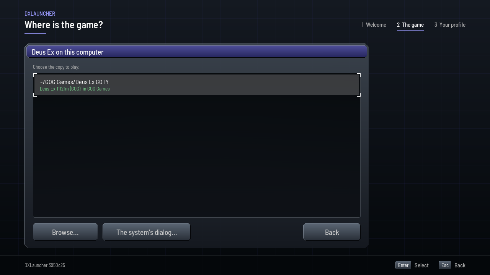
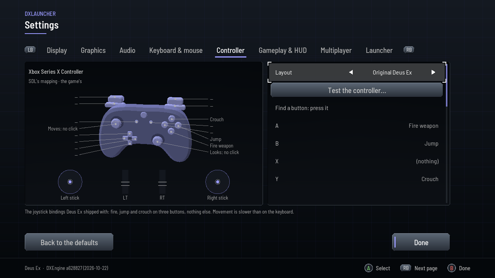
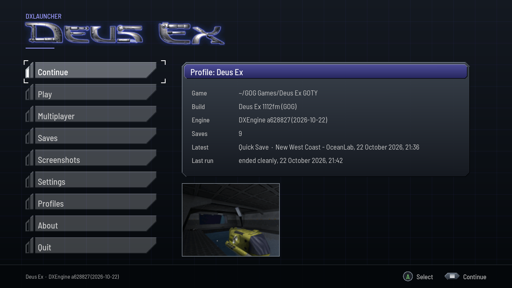

# DXLauncher for Windows

Deus Ex's launcher for Windows 10 (1903) or newer on x86_64: an app of its
own that finds the game, keeps each way of playing in a profile, with its own
settings, saves and screenshots, and starts
[DXEngine](https://github.com/JuggyMcNutty/DXEngine) and stays with it. It
wears the game's look and sound, and takes a keyboard, a mouse or a
controller. It is linux-x86_64's launcher, on Windows' own calls.

<p align="center">
  
</p>

**You need your own copy of Deus Ex, version 1112fm.** None of the game's
files are included. DXLauncher is part of
[Port Ex Machina](https://github.com/JuggyMcNutty/port-ex-machina). Made with
AI assistance.

**Status**: the launcher and the engine play the game under Proton's wine;
they are untried on Windows itself
([verified](ports/windows-x86_64/README.md#verified)).

## Features

- **It finds the game**: the Steam and GOG releases, the CD's install,
  Heroic's GOG games, and the folders Windows' installers use on each drive;
  or it is shown the folder. The first run makes a profile from it, the
  game's settings and keys imported. Nothing in the game's folder is
  written but an ini a command line names (`INI=`, `USERINI=`).
- **Profiles**: one for each way of playing, with its own settings, keys,
  controller, saves and screenshots; made, copied, renamed, or deleted to
  the Recycle Bin.
- **Settings**: those the engine really reads, on eight pages: display,
  graphics, audio, keyboard and mouse, controller, gameplay and HUD,
  multiplayer, and the launcher's own.
- **Controllers**: Xbox, PlayStation, Switch and other pads; a button bound
  by pressing it, a test, and a wizard that maps a pad SDL does not know.
- **Saves and screenshots**: Continue on the latest save, load or delete
  any, look through the game's screenshots.
- **Multiplayer**: the game's servers, from the local network and
  333networks' master server; favourites, passwords, an address joined.
- **Mods**: each played through a profile of its own, its folders first.
- **Recovery**: after a crash, how the run ended, the end of its log, and
  what to try next: another renderer, a window, the defaults.
- **The big screen**: full screen, for a television, on its own under
  Steam's Big Picture.
- **The game's look and sound**: its art, its menu theme's colours, its
  title music and menu sounds, read from the install as it runs.

## Screenshots

<table>
  <tr>
    <td width="50%"></td>
    <td width="50%"></td>
  </tr>
  <tr>
    <td align="center">The first run finds the game</td>
    <td align="center">Saves, each with its snapshot</td>
  </tr>
  <tr>
    <td width="50%"></td>
    <td width="50%"></td>
  </tr>
  <tr>
    <td align="center">Settings: the engine's graphics</td>
    <td align="center">A controller, as the game binds it</td>
  </tr>
  <tr>
    <td width="50%"></td>
    <td width="50%"></td>
  </tr>
  <tr>
    <td align="center">The game's servers</td>
    <td align="center">The big screen, with a pad</td>
  </tr>
</table>

The shots are of this branch's build, under Wine.

## Download

Take `DX-windows-x86_64.zip` from
[Port Ex Machina's releases](https://github.com/JuggyMcNutty/port-ex-machina/releases):
DXLauncher with DXEngine. Unzip it anywhere and run
`DXLauncher\deusex-launcher.exe`; its About page adds it to the Start menu.
This repository's releases tagged `windows-x86_64-<date>-<commit>` have the
launcher alone.

## Building

Port Ex Machina fetches this branch beside the engine and cross-builds both
on a Linux PC with llvm-mingw, then tests and runs them under Wine
([the port](ports/windows-x86_64/README.md#build-and-run)):

```sh
scripts/dx.sh deps  windows-x86_64  # llvm-mingw, the sources, the Wine prefix
scripts/dx.sh build windows-x86_64  # the launcher, then the engine
scripts/dx.sh test  windows-x86_64  # the PC's tests, then Windows' under Wine
scripts/dx.sh stage windows-x86_64  # build/windows-x86_64/app, and its zip
scripts/dx.sh run   windows-x86_64  # under Wine, on the gamefiles/ beside it
```

## The branch

`windows-x86_64` is the branch for Windows on x86_64: DXLauncher's source,
with Windows' calls in `src/platform/win32/` and the finder's Windows places
in `src/core/finder_places_win32.c`, and the port (`ports/windows-x86_64`,
its preset in `CMakePresets.json`). Cross-built it makes
`deusex-launcher.exe`, `dxl-cli.exe` and `dxl-shots.exe`, and the tests,
which run under Wine; its host build, `ports/linux-x86_64/port.cmake` and
its preset, makes them for the PC and runs the tests there too. Its launcher
is linux-x86_64's, and each launcher commit comes over from there by a
deliberate cherry-pick; nothing merges into it, `main` included
([the branches](https://github.com/JuggyMcNutty/port-ex-machina/blob/main/docs/PORTING.md#the-branches)).

## Documentation

- [`docs/LAUNCHER.md`](docs/LAUNCHER.md): the launcher, from the files it
  writes to its known defects.
- [`ports/windows-x86_64/README.md`](ports/windows-x86_64/README.md): the
  port, what differs from linux-x86_64 and what is verified.
- The other platforms, each a branch of its own:
  [Port Ex Machina's ports](https://github.com/JuggyMcNutty/port-ex-machina/blob/main/README.md#engine-ports).
- How ports work:
  [`PORTING.md`](https://github.com/JuggyMcNutty/port-ex-machina/blob/main/docs/PORTING.md).

## License

[zlib](LICENSE); what the app carries of others' -- its fonts and
libraries, the programs' runtimes, the engine and its OpenAL Soft -- under
their own terms ([`THIRD-PARTY.md`](THIRD-PARTY.md)). Deus Ex belongs to its
owners; this project is not affiliated with or endorsed by them.
