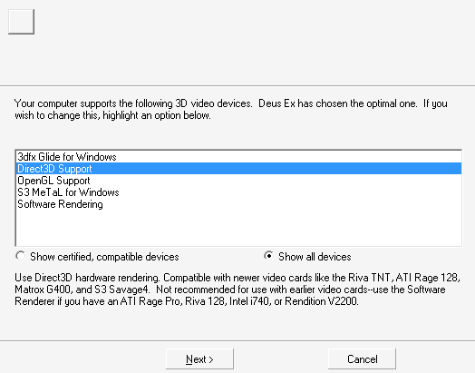
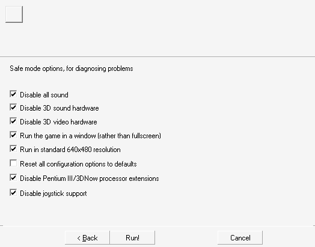
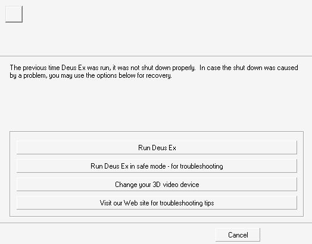

# deusex-launcher

Deus Ex's launchers, part of
[Port Ex Machina](https://github.com/JuggyMcNutty/port-ex-machina), which
brings the game to modern platforms on
[DXEngine](https://github.com/JuggyMcNutty/DXEngine). Each platform has a
branch of its own with DXLauncher, a launcher of our own for it; this
branch, `main`, is the original launcher, `System/DeusEx.exe`, recreated
almost 1:1 for desktop Linux. Made with AI assistance.

<p align="center">
  
  <br><sub>DXLauncher, on the linux-x86_64 branch</sub>
</p>

You need your own copy of Deus Ex (version 1112fm); none of the game's files
are included.

## Branches

| Branch | What it is |
|---|---|
| `main` | the original, recreated almost 1:1 -- no additions, no ports; the reference the port branches start from |
| `linux-x86_64` | desktop Linux, where the project is developed: DXLauncher, the desktop's own launcher, begun from this one ([its `LAUNCHER.md`](https://github.com/JuggyMcNutty/deusex-launcher/blob/linux-x86_64/docs/LAUNCHER.md)), with the desktop's port around it |
| `linux-aarch64` | aarch64 Linux with an ordinary distro: DXLauncher, as linux-x86_64 has it ([its `LAUNCHER.md`](https://github.com/JuggyMcNutty/deusex-launcher/blob/linux-aarch64/docs/LAUNCHER.md)), cross-built or native, with the port around it |
| `windows-x86_64` | Windows 10 (1903) or newer on x86_64: DXLauncher, as linux-x86_64 has it, on Windows' own calls ([its `LAUNCHER.md`](https://github.com/JuggyMcNutty/deusex-launcher/blob/windows-x86_64/docs/LAUNCHER.md)), cross-built by llvm-mingw, with the port around it |
| `trimui-smartpro` | the TrimUI Smart Pro (spruceOS): DXLauncher, linux-aarch64's, tailored to the handheld ([its `LAUNCHER.md`](https://github.com/JuggyMcNutty/deusex-launcher/blob/trimui-smartpro/docs/LAUNCHER.md)), with the device's port around it |

Each port branch's launcher is DXLauncher, the Smart Pro's tailored to the
device, released for its platform with the engine in
[Port Ex Machina's releases](https://github.com/JuggyMcNutty/port-ex-machina/releases).
Nothing merges between the branches, `main` included: a change crosses only
by a deliberate cherry-pick
([the branches](https://github.com/JuggyMcNutty/port-ex-machina/blob/main/docs/PORTING.md#the-branches)).

## The original, recreated

`main` recreates `DeusEx.exe` from the reverse-engineering record in
[dx-reverse-info](https://github.com/JuggyMcNutty/dx-reverse-info): its
launch sequence, its first-run wizard and safe mode, its command line, its
crash detection and its single-instance handoff. Port Ex Machina runs it
with DXEngine in the game's `System` folder. The recreation is whole: the
core (`src/core/`), the launch sequence (`src/launch/`) down every road it
can end by, the wizard's six pages, the splash and the two message boxes,
with unit tests for each and a live check of every road a player can take
([checking it live](#checking-it-live)).

<table>
  <tr>
    <td width="33%"></td>
    <td width="33%"></td>
    <td width="33%"></td>
  </tr>
  <tr>
    <td align="center">The wizard's renderer page</td>
    <td align="center">Safe mode's options</td>
    <td align="center">Recovery, after a crash</td>
  </tr>
</table>

Each is the recreation's own drawing, the same to the pixel as the
original's under Wine ([the look](#the-look)).

## Installing

`DeusEx` goes in the game's `System/` folder beside the original's
`DeusEx.exe`, with `run-game.sh` and the engine's `DXEngine` and
`DXEngine.pk3`. Port Ex Machina's
[`scripts/recreation.sh`](https://github.com/JuggyMcNutty/port-ex-machina/blob/main/scripts/recreation.sh)
puts them there (`build`, then `install [<GameDir>]`); by hand,
`cmake --install build --prefix <GameDir>/System` and copy in the engine's
two files. Start `System/DeusEx` with the original's command line, from
anywhere: like the original, it finds the game and its package by its own
folder and name.

While `DeusEx` is there, the original game does not start under Wine or
Proton: it takes that file for its `DeusEx` package and stops
([a package's file](https://github.com/JuggyMcNutty/dx-reverse-info/blob/main/core-dll.md#packages-and-linkers)).
`scripts/recreation.sh uninstall` removes the four files.

## The look

The screens are the original's, drawn with SDL2: each control where
`Window.dll`'s and `DeusEx.exe`'s dialog templates put it
([page layouts](https://github.com/JuggyMcNutty/dx-reverse-info/blob/main/wizard.md#page-layouts)),
in the colours, fonts and details the original shows under wine.
`tools/pageshots.c` draws each screen with no display. Beside captures of the
original, 14 of the 15 match to the pixel; the splash differs only in its
picture, which wine shows colour-reduced.

Fonts come from a wine or Proton install: MS Sans Serif (`sserife.fon`) for
the pages, Arial at 12 pixels for the Driver page's link, Tahoma 8 pt for
the message boxes. Without wine, Liberation Sans or DejaVu Sans stand in;
`DXL_FONT`, `DXL_FONT_URL` and `DXL_FONT_MSG` name others. Text is
unsmoothed and unkerned, as Windows draws it. The error box's icon is
wine's `user32.dll` `IDI_HAND`, read from the same install
([`peicon.h`](src/core/peicon.h)) and blended as wine blends it
([`dialog.c`](src/gui/dialog.c)); without wine, one is drawn.

## Where it differs from the original

- **The game is a program of its own**, started and waited for
  ([below](#the-game-and-the-launcher)); the original's process becomes the
  game.
- **Detection finds no 3D device**: no Windows driver starts here, so the
  Renderer page leaves every device incompatible and picks the software
  renderer, unless the configuration says otherwise
  ([`renderdev.h`](src/core/renderdev.h)): DXEngine then draws on the CPU,
  as the original's software renderer does, and for any other device chosen
  with its Vulkan device, on the CPU again where that does not start, unless
  its own `Settings.json` names a device
  ([which device draws](https://github.com/JuggyMcNutty/DXEngine/blob/main/docs/ENGINE.md#rendering)).
- **Safe mode's eight boxes are all wired**; in the original three do nothing
  and one does four boxes' work
  ([the shipped bug](https://github.com/JuggyMcNutty/dx-reverse-info/blob/main/wizard.md#-shipped-bug-three-safe-mode-checkboxes-are-dead)).
- **Safe mode and the game's `RELAUNCH` relaunch after the run has ended**,
  this process becoming the launcher again; the original starts a second
  process while it is still ending.
- **A missing splash bitmap is not fatal**: no splash shows. The original
  asserts and dies.
- **Web pages open with the desktop's handler** (`xdg-open`).
- **No log window.** The original opens one every run, shown with `-log`;
  here `-log` only keeps the splash away, and the log is the file,
  `<Package>.log`, as the original's is too.
- **A launch beside a running one appends to the log** (a bypass word's,
  one beside `-server`'s): the original's second writer fails to open the
  file, which the first holds with read sharing alone, and that launch runs
  without a log.
- **The window frames are the desktop's.** The wizard's carries the game's
  icon from the install's `DeusEx.exe` ([`peicon.h`](src/core/peicon.h));
  the message boxes and the splash have none, as in the original.
- **A flag's name ends at a space, a `?` or the line's end** (`ParseParam`,
  `src/core/cmdline.c`); the original's (`Core.dll` `0x10146d00`) checks
  nothing after it, so there `-safemode` counts as `-safe` and `-log` is found
  in `-LOG=<file>`
  ([the parsers](https://github.com/JuggyMcNutty/dx-reverse-info/blob/main/cli-flags.md)).
  Both take `/` as a switch, and a Linux path is full of them: the original's
  rule would find `-server` in `INI=/srv/server/x.ini`. A path that ends in a
  flag's name still counts. The `?` is for a URL's options: the game's
  dedicated-server `RELAUNCH` puts `-server` among them.
  `tests/test_cmdline.c` asserts the launcher's way.

## The game and the launcher

The original's process becomes the game, so its launcher code stays for the
whole run: it holds the single-instance lock a second launch finds, closes
the splash when the engine is up, hands on what a second launch forwards,
and deletes `Running.ini` when the game ends cleanly. Here the engine is a
program of its own, `run-game.sh` started beside the launcher with the
command line as given, its output in the launcher's log. The launcher stays
as its parent and does the same -- and, for the game's `RELAUNCH`, starts
DeusEx again, which the original's engine does itself -- over a socket whose
descriptor the engine finds in `DXL_LAUNCHER_FD`, one text line per message:

| From | Line | Meaning |
|---|---|---|
| the engine | `hello` | it speaks this line; an engine silent for 2 s is taken not to, and the splash closes |
| the engine | `ready` | it is up, its first map in: the splash closes, as the original's does when the engine exists |
| the launcher | `TakeFocus` | a second launch forwarded its command line: the game's window to the front |
| the launcher | `Open <url>` | then the command line's first word, unless it starts with `-`: travel there |
| the engine | `relaunch <line>` | the game's `RELAUNCH`: once the game has ended cleanly, the launcher starts again with that command line alone, as the original's starts `DeusEx.exe` with it ([`RELAUNCH`](https://github.com/JuggyMcNutty/dx-reverse-info/blob/main/core-dll.md#relaunch)); after a crash, not |

A forwarded command line that arrives before `ready` is dropped, as the
original's log window drops one before its main loop runs.

`run-game.sh` starts the engine from `System/` with the launcher's package's
ini (`DeusEx.ini`, or a mod's the launcher is renamed to, `DXL_PACKAGE`) and
`User.ini`, the files the launcher opened, in whatever case the install has
them (`DXL_INI`, `DXL_USERINI`), its log streamed into the game's
(`--verbose`, so a critical error opens the engine's own window, as the
original's box), and the command line as one string, `--cmdline=`
([what the engine reads of it](https://github.com/JuggyMcNutty/DXEngine/blob/main/docs/NATIVES.md#the-command-line));
`DXL_ENGINE_ARGS` adds engine options of its own, for a scripted run. Asked to
stop (SIGINT, SIGTERM, SIGHUP), the launcher sends the game SIGTERM, and
SIGKILL if it still runs 5 s later
([how the engine takes them](https://github.com/JuggyMcNutty/DXEngine/blob/main/docs/ENGINE.md#running-it)).
DXEngine quits on SIGTERM as a closed window does, a `-server` run's too, so
the game ends cleanly. One killed has not: `Running.ini` stays, and the next
launch opens RecoveryMode, as after a crash.

## Building

```sh
cmake -B build -DCMAKE_BUILD_TYPE=Release
cmake --build build
ctest --test-dir build      # CMake 3.20 or later; else cd build && ctest
```

C11, with SDL2 and SDL2_ttf (through `pkg-config`) for `DeusEx` and its
screens; `-DDXL_SCREENS=OFF` builds the core and its tests alone. The tests
need no display. `test_gamefiles` checks a real install when
`gamefiles/System` holds one, and `test_wizard` clicks through the pages
drawn into memory when a font is found; each is skipped otherwise.
`build/pageshots gamefiles/System shots/` draws the screens as pictures from
an install's strings and configuration, writing nothing there.

### Checking it live

With `DeusEx` installed, `tools/livecheck.py <GameDir> <out dir>` (or Port
Ex Machina's `scripts/recreation.sh check`) runs every scenario its header
lists, end to end, on a copy of the install (the files a run writes copied,
the rest linked) and a private X display where `xdotool` clicks, so neither
the install nor the desktop is touched. It needs Xvfb, xdotool,
ImageMagick's `import`, libX11 and `pgrep`, and leaves its screens and logs
in the out dir.

## License

[zlib](LICENSE). Deus Ex belongs to its owners; this project is not
affiliated with or endorsed by them.
